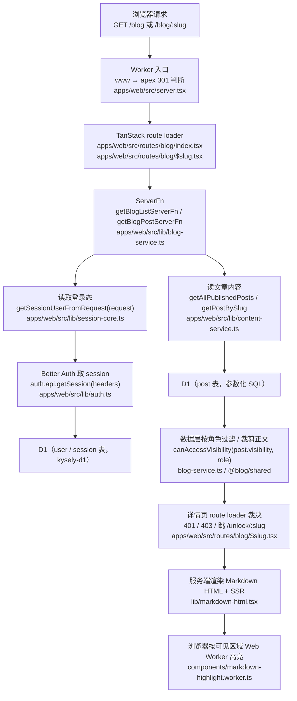
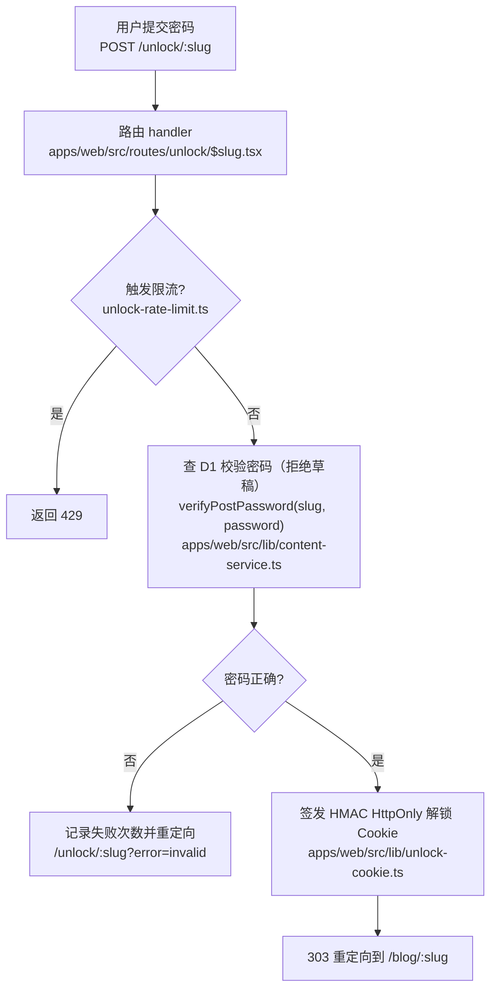

# 页面访问调用链路

本文描述「用户打开博客页面、提交密码解锁或读写评论」时的服务端调用链与文件归属。当前全站运行在 Cloudflare Worker + D1 上：文章、评论和用户会话全部存在 D1（`post`、`comment`、`user`/`session` 表），无 CMS、无构建期内联 markdown。完整架构约束见 [`overview.md`](overview.md)。

## 1) 读文章列表与详情：`GET /blog`、`GET /blog/:slug`

- 会话读取与文章查询并行执行，权限裁决在两者完成后进行；无权查看时在数据层即置空正文，防止直接 RPC 调用 server fn 绕过 route loader。
- 详情页通过可见性门后，再调用 `getCommentsServerFn`（`lib/comments-service.ts`）读取 D1 `comment` 表（服务端同样在 handler 内重校验会话与文章可见性，并在 worker 上把评论正文渲染为无 `rehype-raw` 的 HTML）。

## 2) 密码文章解锁：`POST /unlock/:slug`

## 3) 关键代码定位

- Worker 入口（`www → apex` 301）：`apps/web/src/server.tsx`
- 登录态入口：`apps/web/src/lib/session-core.ts`
- 页面服务端聚合与搜索：`apps/web/src/lib/blog-service.ts`
- 文章读写与密码校验（D1 `post` 表）：`apps/web/src/lib/content-service.ts`
- 评论读写与鉴权（D1 `comment` 表）：`apps/web/src/lib/comments-service.ts`
- 认证（Better Auth on D1）：`apps/web/src/lib/auth.ts`
- Markdown 服务端渲染与浏览器高亮：`apps/web/src/lib/markdown-html.tsx` + `apps/web/src/components/markdown-highlight.worker.ts`
- 详情页权限裁决：`apps/web/src/routes/blog/$slug.tsx`
- 解锁流程：`apps/web/src/routes/unlock/$slug.tsx` + `apps/web/src/lib/unlock-cookie.ts` + `apps/web/src/lib/unlock-rate-limit.ts`
