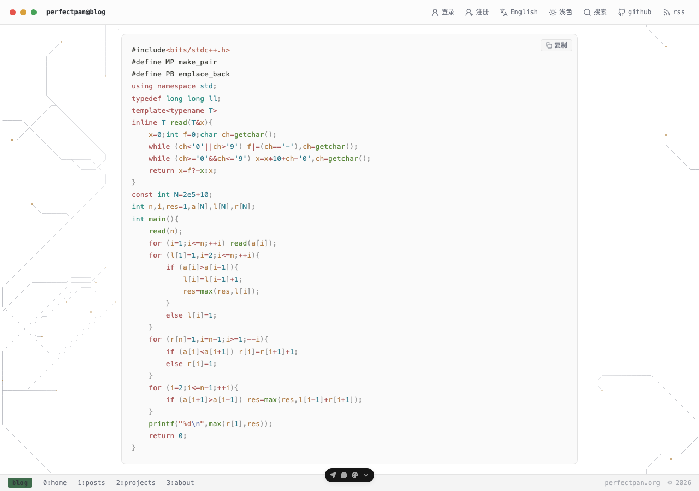
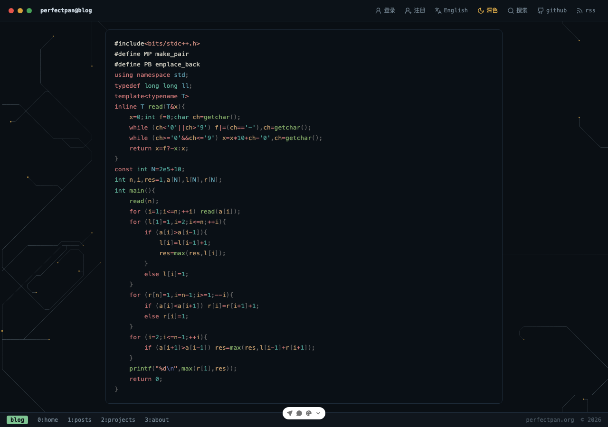
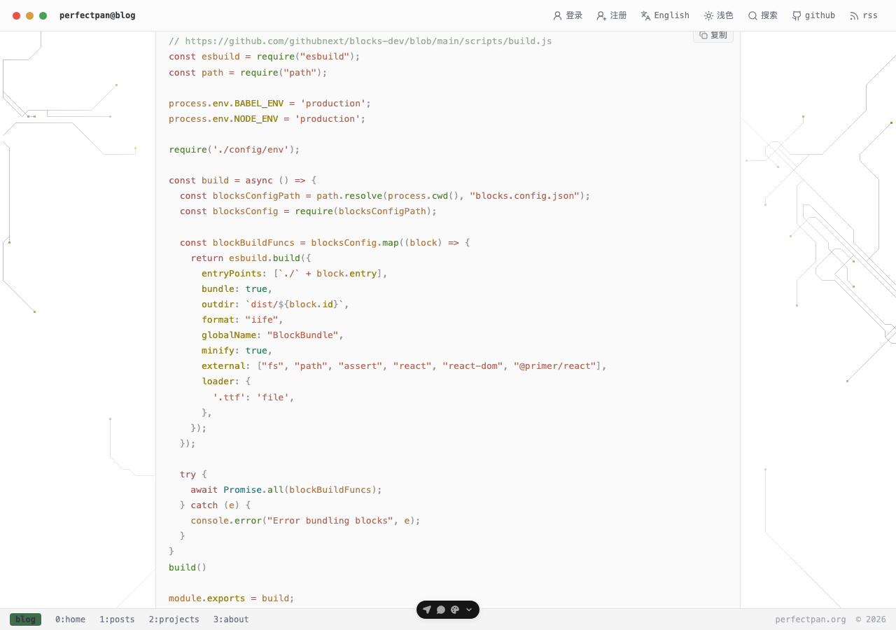
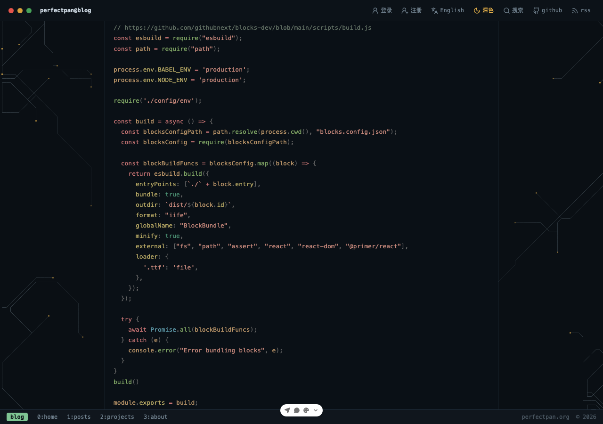

# 视觉回归：@pierre/highlights 代码高亮（feat/web-highlights-engine）

- 日期：2026-10-24
- 环境：`pnpm dev`（vite dev，localhost:5173），真实 Chromium（仓库自带 @playwright/test 1.61，headless，viewport 1280×900）
- 页面：`/blog/codeforces-round605`（3 个 `cpp` 块）、`/blog/blocks`（2 个 `js` 块 + 1 个 `html` 块）
- 结论：**全部通过（5/5 项）**，无失败项

## 截图

| 明色 | 暗色 |
| --- | --- |
|  |  |
|  |  |

四张截图均经视觉核验：明色为 vitesse-light 色板（米白面板 #fafafa），暗色为 vitesse-dark 色板（深色面板 #0a1016），代码块均在正文栏内、无溢出/重叠/截断。

## 逐项结论

### 1) 明/暗 token 颜色（vitesse 风格）✅

- 明色（`html` 无 `dark`）：codeforces 块内 10 种 distinct token 色（前景 `rgb(57,58,52)` + 红/橙/青/绿/紫等），blocks 块 9 种；面板底色均为 `rgb(250,250,250)`。
- 点击站内暗色开关后 `html.dark` 置位，token 色整体切换为 vitesse-dark 色板（如前景 `rgba(219,215,202,0.933)`），面板底色变 `rgb(10,16,22)`；两页 `darkColorsFollow=true`（明暗色板集合完全不同）。

### 2) 布局未破 ✅

- 正文容器（`Page` 的 `mx-auto w-full max-w-220 …`，page.tsx:24）：computed `max-width: 880px`、`clientWidth: 880px`、1280 视口下左右留白各 200px（居中），两页一致。
- 长行横向滚动：blocks 页 html 块（单行 iframe URL）`scrollWidth 6352 > clientWidth 834`，实测块内 `scrollLeft` 0→600 可滚且 `window.scrollX` 保持 0（页面不被撑破）；全部块 `overflow-x: auto`。codeforces 页 3 块当前内容不溢出（834=834），未触发滚动。
- 行高/字号：`font-size: 13px`、`line-height: 22.1px`（=1.7 倍，styles.css `:root .md pre.th-pre` 规则生效）。

### 3) 复制按钮 ✅

- 点击后 `data-copied="true"` 置位，~1500ms 后自动移除（两页均验证；blocks 页首测因读取早于 async clipboard 完成而未见置位，轮询复测确认置位/重置均正常）。
- `pre.textContent` 与初始纯文本源逐字节一致（codeforces 821 字符、blocks 945 字符，`preTextEqualsSourceAfterHighlight=true`），剪贴板读回内容与源文本相同——无多余空白、无行号。

### 4) 渐进增强 ✅

- 初始（domcontentloaded 后立即读取）：两页全部代码块 `data-highlighted` 未置位、`span` 数为 0 —— 纯文本。
- 视口内块自动上色：codeforces 首块（top 532 < 900）无需滚动即高亮（331 个 token span）；此时下方两块仍为纯文本。
- 滚动后依次上色：滚动到块 1 → 高亮（432 spans），再滚动到块 2 → 高亮（680 spans）；blocks 页滚动到首块后亦上色。
- 附注（非缺陷）：正文在 app-shell `main` 内部滚动容器内，IO 的 400px `rootMargin` 预载带不穿透祖先 overflow clip——位于视口下方 400px 内但被容器裁剪的块（blocks 首块，top 1104 > 视口 900）不会提前预载，滚入可视区才上色。已用原生 IntersectionObserver 对照实验证实该块被裁剪（rect [1104,1960] vs rootBounds [-400,1300] 仍 `isIntersecting=false`）。这是标准浏览器行为，"可见→上色、不可见→滚动后上色"的语义正确。

### 5) diff 红绿行 —— 未验证（本地无 diff fence）

两篇文章 SSR HTML 与运行时 DOM 均无 `language-diff` 代码块，按任务约定记为说明、不算失败。worker 侧 diff 注色逻辑存在（`markdown-highlight.worker.ts:9-23` 注入 `diff.plus/diff.minus` 色），`docs/reports/assets/2026-10-24-highlights-samples.html` 静态样张含 diff 样本，但未在站内文章渲染路径中实测。

## 环境与工具说明

- 先用 browser-use:control-browser（IAB）打开页面：hydration、复制按钮逻辑、worker 高亮管道本身均正常，但该 webview 的 IntersectionObserver 对视口内元素不产生任何回调（独立对照 4s 零回调），无法验证滚动上色；clipboard 因 `Document is not focused` 不可用。
- browser-harness（本地 Chrome CDP）因 macOS TCC 拒绝读取 `~/Library/Application Support/Google/Chrome/DevToolsActivePort` 无法启动（`--doctor` FAIL）。
- 最终以仓库自带 Playwright 驱动真实 Chromium 完成上述全部验证与截图，原始数据见 `/tmp/vr-report.json` 及本节描述的各次实测。
- blocks 页有 4 个图片 404（`/api/asset/images/legacy/github-blocks*.png`）：文章引用的 legacy 图片不在本地环境，与高亮引擎无关。
